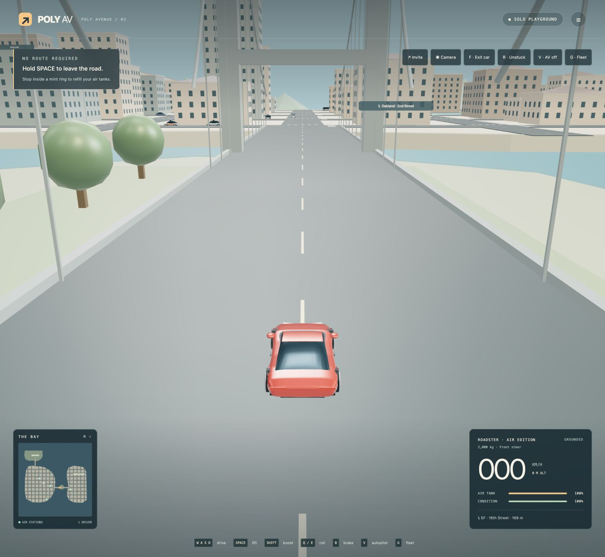

# Poly AV

Formerly Bay Drive. A small, playable multiplayer driving sandbox inspired by the San Francisco Bay Area. Pick up food and deliver it for cash, dodge police, jump and flip a Roadster, swap cars, and refill compressed air at real-world Tesla Supercharger identities placed on a deliberately compressed map. Start in San Francisco and unlock Oakland, the Peninsula, Fremont and San Jose through deliveries; the full circuit is about 19.9 game km. The Golden Gate and Rocket Dome are available from the start.

**[Play Poly AV](https://polyav.swyx.io)** · [Changelog](https://polyav.swyx.io/changelog/) · [Dev blog](https://polyav.swyx.io/blog/) · [Staging preview](https://staging-bay-drive.swyxio.workers.dev) · [Contribute](CONTRIBUTING.md) · [Deploy your own](docs/DEPLOYMENT.md)

This checkout contains the Rocket Island expansion and Rocket Dome; the public link may still serve an earlier version. See [verification](docs/VERIFICATION.md) for observed checks.



**Delivery:** Pick up at a gold marker and stop at the customer. Reach the restaurant quickly for a pickup bonus, then beat the active-time delivery estimate for another bonus; late deliveries pay less. Deliveries and total earnings unlock more of the map for your session, with longer runs as it opens. Spending money or paying a ticket does not undo an unlock. The HUD shows the next milestone. Flying near police can lead to a citation; some rocket-equipped orders lead to rooftops. See [delivery design](docs/DELIVERY.md).

**Sound:** An original synthesized 8-bit soundtrack and driving effects accompany the game. Use **♫** for master, music and effects levels or to mute; settings stay on this browser. See [audio design](docs/AUDIO.md).

**Rocket Dome:** Open Actions and choose ⚽ Rocket Dome to travel to a fictional Alcatraz soccer arena connected to Rocket Island by a drivable approach. Anyone can hit the shared ball into either colored goal; the first side to five wins and a new match starts automatically. Rocket-capable cars can drive up the curved walls and across the ceiling. Use Leave Dome to return to the Bay or island where you entered.

**Global chat:** Pick a driver name and chat with players across rooms, including from solo play. Names in use are distinguished with a suffix such as `#2`; a player ID also distinguishes chat senders. You can optionally save your chat identity with a generated recovery code. Keep that code private: anyone with it can use the identity. Recovering restores your chat ID and saved name, not your car, money, or game progress.

**Bay sights:** Explore 100 additional low-poly landmarks around San Francisco, Marin, Oakland, Berkeley, the Peninsula, Fremont and San Jose, plus Twin Peaks and Mount Tamalpais. Three small, drivable hills evoke those summits and Mission Peak. Locations, sizes and slopes are playful approximations. Roadside billboards advertise fictional parody tech companies. See [map details](docs/MAP.md) and the [northern](docs/BAY_LANDMARKS_NORTH.md) and [southern](docs/BAY_LANDMARKS_SOUTH.md) place references.

**Fleet:** Choose from 11 Teslas. Waymo, Cruise and Zoox vehicles join the Teslas in parked and NPC traffic; exit your car and take one from the street. All 26 families are drivable. Published versus estimated values are documented in [fleet research](docs/FLEET_RESEARCH.md).

**Rocket shops:** Collect a purple rocket pickup to equip any car for flight for its session lifetime, or spend delivery cash at a fictional SpaceX shop. An optional fictional OTA subscription costs $5 per game hour (two real minutes) and opens the shop remotely; it pauses when renewal cannot be paid and resumes when funded. Buy efficient nozzles, larger air tanks, a sport motor, impact armor, or repairs and air. Upgrades belong to the car while it remains in the session; choosing another Tesla replaces your personal car. See [upgrades and locations](docs/UPGRADES.md).

**Sky currents:** Fly into blue lanes for free speed and air, or ride golden thermals beside Coit Tower, the Transamerica Pyramid and Salesforce Tower for lift and air. Jump into a thermal or double-jump into the low lane over the Bay approach; higher lanes reward exploration. The minimap marks their footprints and lane direction. These are fictional arcade currents, not live weather. See [sky currents](docs/SKY_CURRENTS.md).

**Release history:** The menu shows the current release and, after a successful drive starts, the last-played version and time saved in this browser. The changelog highlights known releases since that visit. History starts with 0.0.1 Alpha; earlier visits cannot be recovered. Browser storage is local to the origin and may be cleared or unavailable; it does not preserve game progress. See [publishing notes](docs/PUBLISHING.md).

**Start here:** [agent contracts](docs/CONTRACTS.md), [game design](docs/DESIGN.md), [asset brief](docs/ASSETS.md), [fleet verification](docs/FLEET_VERIFICATION.md), [ready-to-use agent tasks](docs/AGENT_TASKS.md).

**Planning:** [economy, achievements and property proposal](docs/ECONOMY.md) and [player progression simulations](docs/ECONOMY_SIMULATIONS.md) (not yet implemented).

**Rocket Island:** Take the autonomous ferry from the north SF dock to a fictional island with a banked speed oval, a separate banked lane, an inverted cliff and a short circuit. Rocket pickups on the island and at parking playgrounds equip any vehicle with the Roadster's fictional air moves for its session lifetime. The two playgrounds and four fictional Supercharger lots offer Park It and Cut the queue. These are session-only arcade activities; see [implementation status and remaining checks](docs/ROCKET_ISLAND_PLAN.md).

## Run

Node 22 and pnpm 10.33.1 are recommended. No credentials are needed locally.

```sh
corepack enable
pnpm install --frozen-lockfile
pnpm build
pnpm dev:server
# http://localhost:8787 serves both client and WebSocket server
```

For frontend hot reload, leave Wrangler running and start `pnpm dev` in another terminal. Vite proxies `/api` and WebSockets to port 8787. Cloudflare owns production hosting and multiplayer; solo mode uses the same simulation locally.

```sh
pnpm run ci # tests, TypeScript checks and production build
pnpm exec tsx tests/room.integration.ts http://localhost:8787
pnpm exec tsx tests/chat.integration.ts http://localhost:8787
pnpm exec tsx tests/chat-restart.integration.ts # starts an isolated local Worker
pnpm exec tsx tests/capacity.integration.ts http://localhost:8787 64
```

The network checks need the local Worker running. See [deployment](docs/DEPLOYMENT.md) for a separate Cloudflare deployment and the native build/preview workflow; deploying is not needed to contribute.

### Controls and gamepads

Open **Controls & gamepad** from the start screen or the Actions menu to customize up to two keyboard keys per action, or restore defaults. Bindings stay in this browser; touch controls are unchanged. Space brakes and drifts on the road and flips in the air by default. Browser shortcuts remain available.

Standard-mapped Xbox/PlayStation-style controllers use the left stick to steer, right trigger to accelerate and left trigger to brake and then reverse (or fly backward). A/Cross jumps and holds to hover, X/Square flips, B/Circle boosts, and the bumpers or right stick roll. D-pad up enters/exits, down changes camera, left unsticks and right toggles autopilot. Menu/Options opens the menu; use keyboard, mouse or touch in menus. A controller must return to neutral after connecting, focus loss or a menu before driving resumes. Non-standard controllers are reported as unsupported.

The trigger layout follows familiar racing conventions ([Forza Motorsport accessibility notes](https://forums.forza.net/t/meet-the-most-accessible-forza-motorsport-ever/597587/38)); browser controller detection uses the [Gamepad API](https://developer.mozilla.org/en-US/docs/Web/API/Gamepad_API/Using_the_Gamepad_API).

## Play

- **WASD / arrows:** accelerate, reverse, steer. **Space:** brake; steer while braking or reversing to drift, then release to regain grip.
- **E:** tap to jump (or fictional air jump), hold to hover; J also works. **Space** in the air or **X:** one-tap flip. **Shift:** boost. **Q/R:** manual airborne roll. W/S provide forward/reverse thrust in the air; A/D turn.
- **F:** exit a stopped car / take the nearest empty car within 7 world meters.
- **V:** toggle autonomous cruise (manual input takes over). **G:** Tesla fleet catalog; select a new ride while stopped. **B:** enter a shop when stopped in its purple ring.
- **L:** room leaderboard with cash and active play time. **T:** session achievements.
- **C / Actions → Camera:** cycle chase, first-person cockpit, and wide view. The cockpit follows the car through flips; on foot it falls back to chase. First-person time and whole first-person deliveries appear on the session leaderboard as self-reported. **K:** unstuck recovery, preserving air and condition.
- Touch: steering and pedals; hold Brake or Rev while steering to drift. Drive also thrusts forward in the air; Flip has its own button. Tap Jump / Hover to jump and hold it for fictional thruster hover. Boost, manual roll, brake and toolbar actions support portrait and landscape.
- Each rocket-equipped car starts with a Level 1 tank twice the original capacity. Buy Levels 2–5 at fictional SpaceX shops; each doubles capacity and refills the tank.
- Stop inside a mint station ring or marked charging bay to refill air. Green pickups repair; amber pickups refill air; purple rocket pickups equip flight and refill air. Pickups return after 20 seconds.
- At the north SF dock, drive onto the stationary ferry and stop completely on deck. Cars are secured during a crossing; drive off on arrival. The HUD and dock signs show ferry status and countdown; painted walking lanes, visual gates and a nearby horn mark the crossing.
- Drive over a Rocket pickup on the island or at a parking playground to refill air and equip that vehicle for flight for its session lifetime. The stock Rocket Roadster is already equipped.
- At a marked parking playground, open **Actions** for Park It or Cut the queue. At an island race start, choose a course and join/start through Actions. Cars can bump during races. Keyboard users can reach these actions with Tab and Enter.
- Enter the same room code on multiple devices, or use **Invite** to copy its URL. Invite links open the menu; joining is explicit.

## Boundaries

This is a working foundation, not GTA-scale content or a persistent MMO. Four station identities are sourced from Tesla, but their game positions are compressed artistic placements. Compressed-air refills, repeated air jumps and the game’s thrust and suction tuning are fictional. The Rocket is inspired by a prototype, not a production-car specification. No live charging availability, payment, telemetry, or Tesla account/API integration. No affiliation is implied.

Rooms are ephemeral and public-by-code. Delivery money is fictional and session-only; there is no persistent game progression, shooting, or death/respawn yet. Traffic is deterministic arcade driving, not real AV software. Combat and recovery expansion are designed in `docs/DESIGN.md`. Room state resets on deployment, runtime restart, or last disconnect. Room codes are not access control. Saved chat identities persist separately, but room labels are self-asserted and are not proof of a chat identity. Global chat retains only a recent, transient history, which disappears on server restart.

Capacity defaults to **64**, configurable through `MAX_PLAYERS` in Wrangler up to a provisional ceiling of 128. This is a gameplay limit, not Cloudflare's WebSocket maximum. Player-relevant snapshots and a collision spatial index reduce work in the larger world; increase the ceiling only after measurement. Active real-time rooms incur Durable Object duration and request usage; they do not hibernate while physics runs. Never advertise a connection limit as tested gameplay concurrency.

## Layout

```
shared/game.ts      Pure authoritative simulation and world schema
shared/map.ts       Shared land, bridges, road and collision geometry
shared/north-landmarks.ts  Northern Bay place identities and footprints
shared/south-landmarks.ts  Peninsula, Fremont and South Bay place identities
shared/billboards.ts  Fictional roadside signs and placement
shared/vehicles.ts  26-model registry with provenance and tuning
shared/upgrades.ts  Fictional shop locations, prices and eligibility
shared/sky-currents.ts  Shared sky-lane and thermal volumes
shared/physics.ts   Oriented bodies and mass-based collisions
shared/traffic.ts   Deterministic autonomous routes and traffic demand
shared/delivery.ts  Orders, restaurant data, cash and active-time scoring
shared/police.ts    Police detection, chase and severity-based tickets
shared/achievements.ts  Session awards and flight tracking
shared/day.ts       Accelerated day clock and demand profiles
shared/bridge-signal.ts  Shared Bay Bridge approach meter
shared/stations.ts  Curated real station provenance + game placements
shared/ferry.ts     Authoritative ferry and passenger attachment
shared/island-stunts.ts  Shared bank and cliff surfaces
shared/oval-bank.ts  Shared speed-oval geometry and surface contacts
shared/dome*.ts     Rocket Dome geometry and surface collisions
shared/soccer.ts    Authoritative ball, goals and match state
shared/parking*.ts  Parking playground definitions and rounds
shared/race*.ts     Island courses and race rounds
worker/protocol.ts  Input parser and room capacity policy
worker/index.ts     HTTP routing and one Durable Object per room
worker/global-chat.ts  Global chat and optional saved identities
src/session.ts     Solo/multiplayer transport adapter
src/controls.ts    Keyboard, gamepad and multitouch intent adapter
src/audio.ts       Synthesized music, effects and volume buses
src/audio-events.ts  Presentation cues derived from world snapshots
src/camera.ts      Cockpit and chase camera poses
src/scene.ts       Three.js world and camera
src/sky-currents.ts  Animated sky-lane and thermal markers
src/bay-world.ts   Compressed Bay Area environment and landmarks
src/north-landmarks.ts, src/south-landmarks.ts  Original procedural landmark art
src/billboards.ts  Original parody billboard art
src/island-stunts.ts  Bank and cliff meshes from shared geometry
src/rocket-dome.ts  Dome, goals and ball visuals
src/vehicles.ts    Replaceable procedural visual models
src/main.ts        Menu, instruments, action wiring, minimap
src/style.css      Tailwind entry and responsive visual treatment
content/releases.ts  Dated release notes and current game version
content/posts/     Markdown development posts, rendered to static pages at build
scripts/build-public-pages.ts  Blog and changelog page generator
tests/             Simulation, protocol and live connection checks
```

No framework is needed for this small HUD. Keep the simulation independent from Three.js, the DOM, and Cloudflare. Keep pnpm lockfile committed. Alternative UI or art implementations should obey the contracts before adding dependencies or changing shared gameplay.

## License and attribution

First-party source, documentation and original procedural assets are [MIT licensed](LICENSE). The highway source extract and generated traces are © OpenStreetMap contributors, under the [Open Database License](https://opendatacommons.org/licenses/odbl/1-0/); see [map provenance and the reproducible bake](docs/MAP.md). Third-party dependencies have their own licenses; the bundled three.js notice is in [THIRD_PARTY_NOTICES.txt](public/THIRD_PARTY_NOTICES.txt). Restaurant names identify real places, with fictional in-game locations and no affiliation. Tesla, Waymo, Cruise, Zoox and SpaceX names are used for fictional game content; they do not imply endorsement, and the MIT license does not grant trademark rights.
