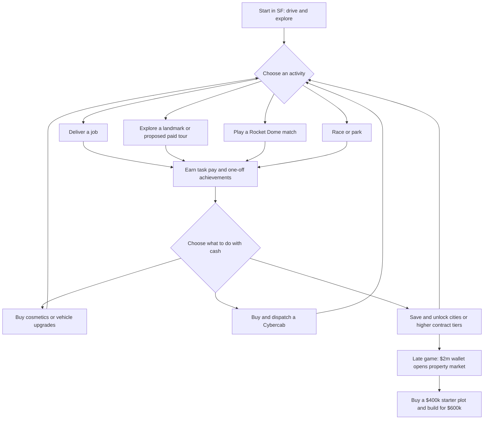

# Five-minute economy and activity branches

**Planning experiment, 2026-10-18.** The player, payout and achievement rules here are hypothetical; these are not observed playtimes or evidence that the game is fun. Deliveries, exploration, the Rocket Dome, race courses and parking games exist in the current game, but the persistent wallet, owned income-producing cabs, paid tours, proposed achievement payouts, balance-based relocking and late property market modeled here do not. See [ECONOMY.md](ECONOMY.md) and [ECONOMY_SIMULATIONS.md](ECONOMY_SIMULATIONS.md) for the broader proposal and its other scenarios.

The desired experience is reasonably consistent money and meaningful achievements as a player chooses among activities. No numerical money target has been agreed. For testing only, use **2–4 one-off achievements per 30 active minutes in the first two hours**, and a **90th-percentile longest achievement-free run of at most 25 minutes**. These are provisional design targets, not guarantees. The experiment does not meet them consistently.

## Reproduce and interpret

```sh
node --experimental-strip-types scripts/economy-five-minute.ts --players 250 --hours 40 --json
node --experimental-strip-types scripts/economy-five-minute.ts --players 250 --hours 40 --events --json
node --experimental-strip-types scripts/economy-five-minute.ts --players 250 --hours 40 --events --all-activities --json
node --experimental-strip-types scripts/economy-five-minute.ts --players 250 --hours 40 --landmarks-per-city 20 --json
node --experimental-strip-types scripts/economy-five-minute.ts --players 250 --hours 40 --city-visits --json
pnpm exec tsx scripts/economy-charts.ts --players 250
```

Each row runs 250 deterministic seeds, 1729–1978, over 40 **active hours**. Five-minute windows cover the first eight active hours; first-two-hour achievement results use 1,000 nonoverlapping 30-minute player blocks per path. The 30-minute earnings metric sums the six five-minute windows and divides by six so it can be compared on the same per-five-minute scale. The percentiles describe these imagined inputs, not confidence intervals or a forecast for real players. Home medians include only players who reached a home; completion counts are shown below. Each player's ledger is checked for conservation.

**Gross income** includes task pay, cab income, repeatable checkpoints, one-off achievements, check-ins and unlock money. It excludes purchases and fines, and the initial $2,500 SF grant precedes the first window. Gross is not the same as wallet change: for example, the cab operator buys vehicles while earning. An empty five-minute window can simply mean a task is still in progress; it does not imply the player did nothing.

Achievement counts include distinct named city-unlock badges as well as other one-off achievements, but their cash is recorded in the unlock category, not counted twice. The initial SF badge occurs before the first window. A four-city level unlock can therefore create four achievement notifications at the same moment. Unranked one-off check-ins and the every-three-activity repeatable checkpoint are tracked **separately**. The broader goal-window metric counts achievements, check-ins, unlocks or repeatable checkpoints; it cannot establish that a player encountered something new or rewarding.

## A possible branching loop



This is a **proposed** choice structure, not a claim that every arrow is currently implemented. Normal fleet access and the existing playable activities should remain available; do not require cab or property purchases to participate. A $25k first cab earns a one-time $5k ownership award in the model; owning it changes earnings potential but spending can also lower the current level. City entry and higher contract tiers depend on current wallet balance, while an already-entered city's local jobs remain available. Home ownership, owned-plot access, player-priced property resale and teleport require separate persistence and multiplayer work.

The path model assumes a player immediately chooses a new task, goes to the next eligible city after **six completed activities**, and has instant access to matches, races, tours and jobs. A cab runs only while its owner is actively playing, at 75% utilization. There are no queues, matchmaking failures, travel to the Dome, cab operating costs or offline earnings. All players have 60-minute sessions. Explorer always selects tours; racer/parker always selects those modes; Dome always selects matches; mixed players use several modes and one cab. The no-win Dome path tests a player who loses every match. These deliberately extreme strategies are useful comparisons, not population estimates.

The **baseline** is the earlier proposed rate: fixed repeatable Dome participation/win cash and race/parking cash. Its paid-tour path is unavailable. The **balanced candidate** makes repeatable match, race, parking and tour payouts scale with the accepted job tier's estimated income per minute. Before achievements, a 50% win rate gives Dome about 85% of the reference delivery rate in expectation; race targets 90%, parking 85%, and tour 80%, using modeled task durations. Match participation pays 70% of its target amount and a win adds 60%, so a loss still pays. These formulas, destinations and rates are a proposal to implement and playtest, not existing game rules. They do not account for real matchmaking or measured completion times.

## Money at five-minute and half-hour scales

The table uses the balanced candidate with events **off**. Values are fictional dollars. `P10–P90` is the range of normalized 30-minute block income, divided by six. These are pooled windows across the stated phase; they are not a guarantee for an individual player.

| Path | Mean gross / 5m, first hour | Mean / 5m, hours 1–4 | Mean / 5m, hours 4–8 | Median 30m gross / 5m, first hour | 30m P10–P90 / 5m, first hour | First-hour windows with zero gross |
| --- | ---: | ---: | ---: | ---: | ---: | ---: |
| Courier | $7,279 | $6,990 | $9,139 | $7,307 | $5,987–$8,603 | 12.1% |
| Explorer | $6,975 | $7,139 | $7,606 | $7,255 | $5,638–$8,530 | 27.0% |
| Dome player, 50% wins | $7,286 | $7,538 | $8,384 | $7,109 | $5,581–$9,925 | 33.1% |
| Dome player, no wins | $5,481 | $5,273 | $5,602 | $5,109 | $4,721–$6,791 | 33.1% |
| Racer and parker | $8,116 | $7,863 | $9,432 | $7,610 | $6,340–$10,605 | 24.1% |
| Cab operator | $9,009 | $10,025 | $11,958 | $8,723 | $7,130–$11,183 | 0% |
| Mixed activities | $8,417 | $8,988 | $10,340 | $8,479 | $7,114–$9,716 | 2.8% |

For example, the courier's median half-hour block in its first hour earns approximately **$43,842 gross** ($7,307 × 6). The first-hour P10 of an individual five-minute window is **$0** for every path without a cab, even when the 30-minute normalized P10 is positive. Steady active-cab accrual reduces zero-gross windows, but buying the fleet also spends money; gross should not be presented as available balance.

Income is expected to grow as players reach higher tiers; constant pacing does not mean freezing earnings across the whole game. The example reference delivery rises from $3k per three-minute level-0 job to $26k per eight-minute level-8 job before variation. Purchases can lower wallet level and accessible high-tier pay. The level-3 local-job floor protects someone already in San Jose, but does not promise access to higher tiers after spending. Actual job routes, travel and performance must be measured before deciding whether these tier increases are appropriate.

## Achievement pacing is still uneven

These are **one-off achievement counts**, including city badges. Check-ins, repeatable checkpoints and unlock cash are excluded as separate categories. Each percentage covers nonoverlapping 30-minute blocks from the first two active hours. The 25-minute threshold below is the proposed P90 maximum for each player's longest consecutive run of five-minute bins without an achievement during that period.

| Path | Achievements / 30m: mean | P10 / median / P90 | Blocks below 2 / at 2–4 / above 4 | Longest no-achievement run: median / P90 |
| --- | ---: | ---: | ---: | ---: |
| Courier | 3.00 | 1 / 1 / 6 | 50.0% / 22.6% / 27.4% | 30 / 35 min |
| Explorer | 4.75 | 2 / 3 / 8 | 3.7% / 46.3% / 50.0% | 20 / 20 min |
| Dome player | 3.06 | 0 / 1 / 6 | 50.4% / 6.0% / 43.6% | 45 / 50 min |
| Dome player, no wins | 2.50 | 0 / 1 / 5 | 50.0% / 25.0% / 25.0% | 45 / 50 min |
| Racer and parker | 4.23 | 1 / 2 / 8 | 34.9% / 20.4% / 44.7% | 30 / 50 min |
| Cab operator | 3.75 | 1 / 2 / 7 | 28.5% / 21.5% / 50.0% | 30 / 30 min |
| Mixed activities | 6.95 | 3 / 6 / 12 | 2.3% / 33.8% / 63.9% | 15 / 20 min |

Only explorer and mixed meet the provisional **P90 ≤25-minute** gap; five paths fail. A mean within 2–4 is not enough: the courier's mean is 3, yet half its 30-minute blocks have fewer than two achievements. City unlocks arriving together inflate some blocks; a burst of badges is not a steady cadence. The explorer and mixed paths can also exceed the upper target frequently, so simply adding more awards will not necessarily make pacing more consistent.

In first-hour five-minute windows, the share with **no one-off achievement** is 62.9% for courier, 35.3% explorer, 62.8% Dome, 58.3% no-win Dome, 40.8% racer/parker, 50.1% cab and 31.1% mixed. Some of those windows do contain check-ins, unlock cash or repeatable goals. Including all of those broader goals, the shares with **no goal** become 21.8%, 35.3%, 56.4%, 48.6%, 37.1%, 21.4% and 26.7%, respectively. Repeatable money therefore provides short-term feedback but cannot be counted as fresh one-off achievements.

The problem persists after the first rush: in hours 4–8 the pure explorer has no further one-off achievement windows with the default **three abstract landmarks per city**, while its repeatable tours continue to pay. A sensitivity run with **20** abstract landmarks per city produces an achievement in 18.1% of those windows, versus 0% with three; its first-two-hour P90 dry run changes from 20 to 10 minutes and its median home time from 21.4 to 21.1 hours. This assumes those landmarks have eligible distinct tour goals and the scripted player can reach them; the 100 modeled IDs are not a verified mapping of the game's real landmarks. Larger landmark supply does not change the courier or Dome gaps in these pure-path profiles. Consider additional spaced, varied goals or longer-term progress meters, but validate their interest and inflation impact; the current experiment does not prove a fix.

### First-visit experiment

The optional `--city-visits` scenario adds one $500 achievement on first physical arrival in each modeled non-SF city, distinct from its balance-based unlock. It awards each modeled city once and keeps the default charts and tables above unchanged. This is an experiment, not an implemented achievement. Its scripted players move through four non-starting cities after six completed local activities; actual city boundaries, destinations and travel require verification.

| Path | P90 longest early gap, default → first visits | Early 30-minute blocks with fewer than two achievements | Median first home |
| --- | ---: | ---: | ---: |
| Courier | 35 → 30 min | 50.0% → 11.2% | 18.3 → 18.3 h |
| Explorer | 20 → 20 min | 3.7% → 0.3% | 21.4 → 21.4 h |
| Dome, 50% wins | 50 → 35 min | 50.4% → 32.2% | 19.7 → 19.7 h |
| Dome, no wins | 50 → 35 min | 50.0% → 31.9% | 28.5 → 28.5 h |
| Racer and parker | 50 → 35 min | 34.9% → 9.4% | 18.8 → 18.7 h |
| Cab operator | 30 → 25 min | 28.5% → 16.9% | 15.3 → 15.3 h |
| Mixed activities | 20 → 15 min | 2.3% → 0.6% | 16.4 → 16.4 h |

First visits improve the dry gap on five paths and bring the cab operator within the provisional gap target; four paths still miss it. They can also worsen the early burst: the mixed path's share of blocks within the 2–4 band falls from 33.8% to 21.0%. These extra awards are worth prototyping because they introduce distinct places, not because the target is solved. Compare goal timing and bundled notifications in playtests, and explore verifiable activity-specific goals for the remaining gaps.

## Property, multipliers and sensitivities

With events off, every balanced-path seed reaches the late property goal in the 40-hour horizon, under the optimistic assumptions above:

| Path | First home median | Reached by 40h |
| --- | ---: | ---: |
| Courier | 18.3h | 250/250 |
| Explorer | 21.4h | 250/250 |
| Dome, 50% wins | 19.7h | 250/250 |
| Dome, no wins | 28.5h | 250/250 |
| Racer and parker | 18.8h | 250/250 |
| Cab operator | 15.3h | 250/250 |
| Mixed activities | 16.4h | 250/250 |

The late property market still requires **$2m current balance** even though the starter plot and build cost $1m combined. Automatic purchases in this model buy both at the same boundary. The no-win path is substantially slower even with improved participation pay; it also assumes continuous available opponents and matches. In the baseline payout experiment, **0/250** pure Dome, no-win Dome and racer/parker players reached a home by 40h. These are deliberately extreme strategies, not promises of comparable real playtime.

Both event variants assume a developer-controlled 2× event for 30 minutes every four hours and a 1.5× room bonus for ten minutes after **this player's own** Dome win, stacked to 3×. The global cadence is invented for simulation. Other players could trigger the proposed room event, but this single-player experiment does not simulate them. The delivery/cab-only variant multiplies delivery earnings and active-cab income. The all-task variant also multiplies match, race, parking and tour pay using the rate at task completion; a win starts its room bonus only **after** that match pays. Neither variant multiplies one-off awards or repeatable checkpoints.

| Balanced path | First-hour mean gross / 5m: off → delivery/cab-only → all tasks | First home median: off → delivery/cab-only → all tasks |
| --- | ---: | ---: |
| Courier | $7,279 → $7,955 → $7,955 | 18.3h → 16.4h → 16.4h |
| Explorer | $6,975 → $6,975 → $7,536 | 21.4h → 21.4h → 19.2h |
| Dome, 50% wins | $7,286 → $7,286 → $8,818 | 19.7h → 19.7h → 14.8h |
| Dome, no wins | $5,481 → $5,481 → $5,911 | 28.5h → 28.5h → 25.4h |
| Racer and parker | $8,116 → $8,116 → $8,758 | 18.8h → 18.8h → 16.9h |
| Cab operator | $9,009 → $9,739 → $9,739 | 15.3h → 14.1h → 14.1h |
| Mixed activities | $8,417 → $8,857 → $9,414 | 16.4h → 15.4h → 14.3h |

All balanced rows reached a home in 250/250 runs under each variant. The broader bonus gives every activity a benefit, including the no-win path through the global event, and brings the winning Dome median forward by 4.9 active hours versus events off. Actual multiplayer may produce substantially different uptime: repeated wins, overlapping events or coordinated win trading could make a room bonus nearly continuous. Before adopting it, model many players and queues, measure bonus uptime and minted currency, and test eligibility, cooldowns or other limits against collusion. The experiments share starting seeds, but the altered economy can change subsequent choices and random draws; these are scenario comparisons, not isolated causal measurements. Even with all-task bonuses, the baseline pure Dome, no-win Dome and racer/parker paths remain 0/250 home owners by 40h.

These results remain sensitive to continuous matchmaking, a fixed 50% win chance, constant availability of repeatable tours, instant choice of high-tier jobs, no idle time and no measured travel or charging. Next, playtest mixed human sessions—including losses, queue time and 30-minute sessions—and record time between *meaningful* new things, actual cash and opportunities, not just badge counts. Tune payout sources and milestone timing together; do not treat a simulator average or a large number of notifications as proof of smooth progression.

## Next experiments

Prototype distinct one-off goals that invite players to try features, rather than awarding another badge for each repeated action:

- **Skill and sport:** Test a first clean lap, a parking challenge at a different location, and Dome contribution goals such as an assist or a save, including paths available to a player who loses. Only award an action the server can verify, and test whether it can be farmed through inactivity or collusion.
- **Landmarks:** Test first visits, deliveries or landings at individually identified locations, such as Salesforce Tower, Coit Tower, SFO and Treasure Island, subject to the actual map and unlocks. Keep the requested per-city unlock badges, but group simultaneous notifications and add separate goals for visiting distinct destinations.
- **Vehicles and cosmetics:** Test first drives in different available vehicle models, a clean race or rooftop delivery in a chosen car, and applying a first cosmetic. Keep ordinary driving accessible without requiring a car purchase; these goals and their prices are proposals, not implemented promises.

Rerun the same 250-seed paths and report the first-two-hour 30-minute block distribution, P90 longest gap, city-badge bursts, cash per five minutes, and home affordability. In particular, test courier and losing Dome paths against both provisional cadence targets, then examine hours 4–8 for the explorer. Test whether broader event payouts remain balanced and resistant to collusion in multiplayer. Keep repeatable checkpoints separate from one-off achievements. Follow the simulation with desktop and touch playtests, including actual queue time; passing these numeric targets alone cannot establish that the activities are fun.
